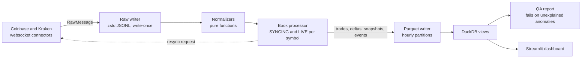

# TickVault

Production-grade crypto market-data pipeline: L2 + trades from Coinbase/Kraken → validated, append-only Parquet + DuckDB, with gap detection, checksum validation and a QA dashboard.

[](https://github.com/broiisapro/tickvault/actions/workflows/ci.yml)
[](LICENSE)

TickVault streams level-2 order books and trades from Coinbase and Kraken, stores every raw message immutably, and turns it into partitioned Parquet you can query with DuckDB. Correctness is the point: it detects sequence gaps and resyncs, validates Kraken's CRC32 book checksums on every update, checks book invariants, and publishes a daily QA report. A replay of the same raw data always produces byte-identical tables.

**Live dashboard:** https://tickvault.streamlit.app (bundled 30-minute sample; may take a few seconds to wake) · **QA report:** https://broiisapro.github.io/tickvault/


## What it demonstrates

- **Immutable raw capture with replay.** Every websocket frame is persisted first (zstd JSONL, write-once) with its receive timestamp, connection id and ingest sequence; replay reads the same bytes through the same normalizer → book → writer path, and no command ever rewrites a raw file (`test_raw_files_unchanged_after_all_commands`).
- **Per-connection sequence-gap detection.** Coinbase Advanced Trade's `sequence_num` is tracked on every message; one missing number emits a `gap` event, moves the symbol to SYNCING and requests a fresh snapshot (`test_single_missing_sequence_is_flagged_and_resynced`); a stale delta from the previous connection is never applied after a resync (`test_no_pre_reconnect_delta_applied_after_resync`).
- **Kraken CRC32 checksum on every book update**, computed from the exact decimal strings. Parsing Kraken's JSON numbers as floats loses trailing zeros (`0.00006120` becomes `6.12e-05`) and the checksum fails — verified against the live feed (`test_checksum_matches_reference_vectors`).
- **Book invariants** after every applied update: crossed book, negative size, duplicate level (`test_crossed_book_is_flagged`, `test_invariant_violation_flags_resync_and_syncing`).
- **Deterministic replay:** two replays of the same raw input produce byte-identical Parquet (`test_two_replays_are_byte_identical`, `test_replay_twice_produces_identical_trees`).
- **QA that fails loudly:** `tickvault qa` exits 1 on any unexplained anomaly or missing book, and writes JSON + Markdown reports per day.
- **Tardis.dev reconciliation** of trades by `trade_id`, fixture-tested; the fixture carries deliberate discrepancies that the report must find.

## Numbers

All figures are from runs on this machine (MacBook Pro, Apple M5, 32 GB). The
benchmark is a replay of recorded sessions and measures processing headroom;
the live message rate is set by the venues.

| Measurement | Value |
|---|---|
| 30-minute live capture (2026-10-15 17:08–17:38 UTC) | 476,965 raw messages — Coinbase 69,618, Kraken 407,347 |
| Rows written | 26,294 trades, 1,840,670 book deltas, 300,926 book snapshots |
| Anomalies, all explained by resyncs | 3 reconnects → 3 resyncs; 0 gaps, 0 checksum failures, 0 invariant violations, `unexplained 0` |
| Receive lag p50 / p99 | Coinbase 65.7–129.2 / 405.3–23,004.9 ms · Kraken 68.4–68.6 / 190.8–197.6 ms (per symbol; the 23 s p99 is reconnect catch-up) |
| Replay throughput (`tickvault bench`, three runs) | 9.6–10.2k msg/s overall — Coinbase 2.3–2.4k, Kraken 7.3–7.7k; peak RSS 223 MB |
| Live message rate (BTC-USD + ETH-USD, both venues) | ≈ 265 msg/s (476,965 messages / 1,800 s) |
| Test suite | 448 tests |

## Architecture



The live path writes every venue frame to the raw layer before parsing it, then normalizes it and applies deltas to a per-symbol book. A detected anomaly — sequence gap, checksum mismatch, invariant violation — emits an `events` row and a resync request; the symbol returns to SYNCING, and deltas received in the meantime are dropped and counted on the following `resync`. Replay orders raw lines by receive timestamp, connection and ingest sequence and feeds the same normalizer, processor and writer, which is why its output is byte-identical. Downstream, DuckDB views read the hive-partitioned tree; `tickvault qa` aggregates it per venue/symbol/day and exits non-zero on any anomaly no resync explains. Every venue behaviour claimed above is backed by the live checks recorded in `docs/architecture.md` (§2); the phase notes live in `docs/epic-00-foundation.md`, `docs/epic-01-feeds-book-storage.md` and `docs/epic-02-pipeline.md`.

## Quick start

```bash
git clone https://github.com/broiisapro/tickvault && cd tickvault
uv sync --frozen                      # Python 3.12 environment managed by uv

uv run pytest -q                      # full suite; live network checks excluded
make bench                            # replay the recorded fixtures, report throughput

uv run tickvault replay --input tests/fixtures/synthetic_gap_session.jsonl.zst --out ./data
uv run tickvault qa --data ./data     # quality table; exits 1 on unexplained anomalies
uv run tickvault sql --data ./data -c "select venue, count(*) from trades group by 1"
uv run tickvault ingest --venues coinbase,kraken --symbols BTC-USD,ETH-USD --out ./data

uv run streamlit run dashboard/app.py # dashboard over the bundled dashboard/sample
make demo-live                        # docker compose: live ingester + dashboard on :8501
make demo-down
```

Phase 1 reads public market data only and needs no API keys.

## CLI

| Command | Purpose |
|---|---|
| `tickvault ingest` | stream live venue data into the raw and normalized layers (`--duration`, `--max-gb`) |
| `tickvault replay` | rebuild the normalized layer from raw files deterministically |
| `tickvault qa` | per venue/symbol/day quality table; exit 1 on unexplained anomalies (`--json`, `--reports`) |
| `tickvault compact` | merge a date's hourly partitions, verify row counts, write a manifest |
| `tickvault sql` | DuckDB views over the normalized tree; `-c` runs one query |
| `tickvault reconcile` | compare captured trades against a Tardis.dev slice (`--tardis-date` or `--fixture`) |
| `tickvault bench` | replay the recorded fixtures and report msg/s and peak RSS |

## Data layout

```
raw/venue=<v>/date=<YYYY-MM-DD>/hour=<HH>/<connection_id>-<rot:05d>.jsonl.zst
norm/<table>/venue=<v>/date=<YYYY-MM-DD>/hour=<HH>/part-<connection_id>-<first ingest_seq:012d>.parquet
```

Four tables under `norm/`: `trades`, `book_deltas`, `book_snapshots` and `events` (plus `manifests/` and `reports/`). Prices and sizes are `decimal(38,18)`; timestamps are int64 nanoseconds UTC parsed by one RFC 3339 parser for 0–9 fractional digits (`test_iso8601_and_rfc3339_parse_to_same_ns`); every row carries `venue`, `symbol`, `exchange_ts_ns`, `recv_ts_ns`, `connection_id` and `ingest_seq`. See `docs/architecture.md` §5–7.

## Testing and CI

`uv run pytest -q` runs the suite offline; checks that talk to the public venues are marked `network` and excluded by default (`uv run pytest -m network` to opt in). CI runs `ruff`, `mypy` (strict) and `pytest` as three required jobs on GitHub-hosted `ubuntu-24.04-arm` runners (`.github/workflows/ci.yml`).

## Limitations

- Two venues (Coinbase, Kraken); reconciliation is fixture-tested against Coinbase only — Kraken and a real Tardis capture are deferred.
- The hosted dashboard serves the fixed 30-minute sample, not a live feed.
- The QA page (GitHub Pages) shows the report for the bundled sample; a daily report from always-on capture is Phase 3.
- No always-on ingestion in Phase 1; the live Tardis reconciliation of a real capture is planned for 2026-11-01.

## Roadmap

- **Phase 2:** a features table with a lookahead test, a third venue, Redpanda buffer + Prometheus/Grafana.
- **Phase 3:** always-on ingestion, public QA history, public sample dataset.

## License

MIT — see [LICENSE](LICENSE).
