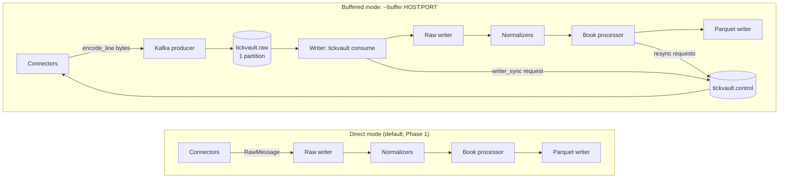

# Epic 6 — Buffer and metrics

## Goal

The Phase 1 ingester writes the raw layer and the normalized layer in one
process. That is the right default for a single machine — no broker to run, no
extra hop, one data root — but it couples collection to processing: a restart of
the process stops collection for as long as it is down, and the messages that
were in flight at the moment of a crash are gone.

Epic 6 adds an optional Kafka-API hop between the two halves (FR-2.3) and makes
the pipeline observable through Prometheus and a provisioned Grafana dashboard
(FR-2.4), without changing the default path: with no buffer configured, the
pipeline is the Phase 1 one, byte for byte, and the Phase 1 definition of done
keeps passing. Turning the buffer on splits one process into two —
`tickvault ingest --buffer <host:port>` publishes every raw envelope line, and
`tickvault consume --buffer <host:port>` is the writer that reads those lines
back and runs them through the unchanged raw writer → normalizer → book
processor → Parquet path.

## How it works

### Direct and buffered flows



In direct mode nothing below the raw writer knows about the buffer: `run_live`
writes each `RawMessage` and then normalizes it in the same task. In buffered
mode the ingester runs only the connectors and the producer — it opens no raw
file and writes no Parquet file — and the writer owns the whole storage half.
Resync requests travel the other way on the control topic, so a book anomaly
detected by the writer reaches a websocket connection that never dropped.

The published bytes are exactly `tickvault.rawio.encode_line(message)` — the
same JSON line, key order and trailing newline the raw writer would have
written, nothing re-encoded. That is what makes a buffered capture
indistinguishable from a direct one: after the writer has drained the topic,
the raw tree is the tree the Phase 1 ingester would have produced.

### Topics

| Topic | Contents | Shape |
|---|---|---|
| `tickvault.raw` | one raw envelope line per record, the exact `encode_line` bytes | 1 partition, replication 1 |
| `tickvault.control` | one resync request per record, JSON `{"venue","connection_id","symbol","reason"}` with sorted keys and compact separators | 1 partition, replication 1 |

`tickvault.raw` has a single partition on purpose: with one partition, the
order in which records were published is the order in which the writer receives
them, so the writer sees one connection's frames in receive order without any
reordering logic. Offsets in that topic are contiguous for the idempotent
producer; the consumer verifies that and raises `OffsetGapError` rather than
silently skipping a hole.

Both topics are created by the first client that starts — the ingester's
`KafkaBuffer.start` asks the admin client for them and accepts
`TOPIC_ALREADY_EXISTS` — and the Compose `redpanda-init` service creates them
ahead of time with the size limits below. Nothing is schema-registered: a
record value is one line of JSON, and the control payload's shape is the four
fields above.

### The 16 MiB record limit

`KafkaBuffer` sizes both clients at 16 MiB (`_MAX_RECORD_BYTES`):

- producer `max_request_size = 16 MiB`;
- consumer `max_partition_fetch_bytes = 16 MiB`.

The default in both cases is 1 MiB, which is far too small for a Coinbase
`level2` snapshot: the payload is the whole book, not a delta, and the longest
envelope in the committed five-minute recording
(`tests/fixtures/coinbase_btc_5m.jsonl.zst`) measures **5,105,095 bytes**. The
producer would raise `MessageSizeTooLargeError` on that frame, and a consumer
limited to 1 MiB could never fetch the record even if the producer had sent it.

16 MiB comfortably holds three envelopes of that size and matches the
broker-side limits. Redpanda caps a record batch at 1 MiB
(`kafka_batch_max_bytes`) and a topic message at 1 MiB (`max.message.bytes`) by
default, so its defaults are too small for the same reason. The
`redpanda-init` service raises both before the first client connects:

```sh
rpk -X admin.hosts=redpanda:9644 cluster config set \
    kafka_batch_max_bytes 16777216 --no-confirm
rpk topic create tickvault.raw tickvault.control -p 1 -r 1 \
    -c max.message.bytes=16777216 --brokers redpanda:9092 || true
rpk topic alter-config tickvault.raw tickvault.control \
    --set max.message.bytes=16777216 --brokers redpanda:9092
```

The topics are created there, rather than only by the client, so the
topic-level limit applies to offset 0; a topic created by the client and
altered afterwards would have a first record written under the old limit. The
cluster setting and the topics live in the `redpanda-data` volume, so a second
run is a no-op (`|| true` covers the existing-topic case).

### Delivery semantics and the three duplicate guards

Delivery is **at-least-once**, not exactly-once. A writer commits an offset only
after the raw writer has flushed everything up to it: an explicit
`RawWriter.flush()` every 1,000 handled records and once more on a graceful
stop (duration, stop event, SIGTERM, SIGINT). A crash therefore replays at most
the uncommitted tail, and that tail can contain envelopes the raw file already
has. Three mechanisms keep the duplicates from reaching the raw layer:

1. **Commit after flush.** The committed offset never describes data that is
   still only in a zstd block buffer, so the replay window is bounded by the
   commit interval rather than by the file size.
2. **The writer's per-process skip.** While replaying the uncommitted tail, the
   writer keeps the `(connection_id, ingest_seq)` pairs it has already written
   since the last commit and drops a record that repeats one, counting it in
   the `duplicates` statistic. The set is cleared on every commit, so it stays
   bounded by the commit interval.
3. **The raw reader's duplicate skip.** `rawio.iter_raw` merges the tree in
   canonical order `(recv_ts_ns, connection_id, ingest_seq)`, where equal keys
   are adjacent, and compares each line's canonical key **and its stored bytes**
   with the previous line. Identical duplicates are skipped and counted in
   `RawReadStats.duplicates`; lines that share a key but not the bytes are
   reported as `conflicts` and yielded, so a real divergence is never hidden.

The consequence is the property replay needs: a raw tree written by several
writer processes (because of restarts) replays exactly like the same messages
written once. The writer's raw files use `RawWriter(resume=True)`, which opens
the next rotation number instead of failing on a file an earlier process
created, so a restart continues beside the previous file without touching it.

Graceful shutdown drains: a set stop event is observed before the next queued
record is taken, the connectors close first, and every frame that already
reached the queue is still published before the buffer closes. An abrupt stop
(exception, cancellation) closes the writers and the buffer **without**
committing, so the next writer replays that tail.

### Writer restart and the `writer_sync` snapshot request

A writer restart creates a new `BookProcessor`, and every per-symbol book starts
in `SYNCING`: deltas are dropped until a snapshot arrives. The ingester, on the
other hand, was never restarted; its websocket connections are still LIVE and
the venues will not send a fresh snapshot on their own. Without help, the
writer would stay in `SYNCING` forever.

The writer therefore watches the book state it observes. The first time it sees
a delta for a symbol whose book is not LIVE, it publishes one
`ResyncRequest(reason="writer_sync")` to `tickvault.control`, at most once per
`(venue, symbol)` per writer process. The ingester's control task decodes the
request and routes it to the connector for that venue
(`connector.resync(symbol, reason)`); the connector performs the venue's resync
(resubscribe or reconnect, whichever the venue needs), the venue answers with a
snapshot, the processor goes LIVE and emits the usual `resync` event.
Anomaly-driven requests from the processor (sequence gap, checksum failure,
invariant violation) take the same path, so the ingester has exactly one resync
entry point.

The writer's offsets are committed after the flush; a restart resumes from the
committed offset and skips only what it already wrote. Its process counters
(`tickvault_buffer_consumed_total` and the rest) start at zero again, so the
smoke script's post-restart reading (8316) is the new process's own count, not
a run total.

### Metrics

`tickvault.metrics.PipelineMetrics` owns a private
`prometheus_client.CollectorRegistry` — never the process-wide default one, so
two instances in one process (or two tests) cannot collide. Every name is
prefixed `tickvault_`; no label carries a secret or anything host-specific.

| Metric | Type | Labels | Meaning |
|---|---|---|---|
| `tickvault_messages_total` | counter | `venue` | raw venue messages received (ingester) or processed (writer) |
| `tickvault_rows_total` | counter | `table`, `venue` | normalized rows written, by table |
| `tickvault_events_total` | counter | `venue`, `event_type` | data-quality events emitted |
| `tickvault_book_live` | gauge | `venue`, `symbol` | 1 while LIVE, 0 while SYNCING |
| `tickvault_raw_bytes_total` | counter | — | raw envelope bytes published or written |
| `tickvault_last_message_age_seconds` | gauge | `venue` | seconds since the last raw message, refreshed once per second |
| `tickvault_normalize_errors_total` | counter | `venue` | raw messages a normalizer rejected |
| `tickvault_buffer_consumed_total` | counter | — | raw records the writer consumed |
| `tickvault_buffer_lag_messages` | gauge | — | raw records published but not yet handled by the writer |

`rows_total` is incremented even when a table wrote zero rows, so a dashboard
shows a table that is present and quiet instead of a gap. The lag is
`end_offset() - next_offset_to_consume`, where `end_offset` is the offset the
broker would assign next (one past the last published record) and the writer's
position is the offset of the first record it has not handled yet. It is
refreshed at most once per second, and a buffer that cannot report its end
offset (or errors while doing so) leaves the gauge at its previous value
instead of reporting a made-up number — lag is observability and never fails
the writer. A writer that has not handled its first record yet publishes no
lag value.

Metrics are opt-in per process: `--metrics-port N` (or `TICKVAULT_METRICS_PORT`)
serves the registry over HTTP; 0 or unset means off. The Compose stack uses 9108
for the ingester and 9109 for the writer. Metrics are observability only —
nothing in the data path reads them, and the tests feed them directly.

### Compose: profiles, ports and `redpanda-init`

`docker compose up -d` is still the Phase 1 stack: ingester and dashboard. Two
opt-in profiles add the Phase 2 pieces:

| Profile | Services | Purpose |
|---|---|---|
| `buffer` | `redpanda`, `redpanda-init`, `writer` | broker, topic/limit setup and the buffered writer |
| `metrics` | `prometheus`, `grafana` | scrapes 9108/9109; one provisioned dashboard |

`make demo-buffer` sets `TICKVAULT_BUFFER=redpanda:9092` and brings both profiles
up with a build:

```sh
TICKVAULT_BUFFER=redpanda:9092 docker compose --profile buffer --profile metrics up -d --build
```

The address is an environment variable because a Compose profile cannot change
the command of a service that already exists: the enabled profile starts the
extra services, and the ingester's `--buffer` flag reads the variable (empty or
unset means off, so the same service definition runs the direct path). The
ingester declares the broker and its init service as `depends_on` with
`required: false`, so with the profile off those dependencies simply do not
apply and the Phase 1 stack starts unchanged.

`redpanda-init` is a one-shot container running the same Redpanda image. It
waits for the broker's healthcheck, raises the two size limits, creates both
topics and exits; `depends_on: service_completed_successfully` makes the
ingester and writer wait for it, so the first record is never published into a
half-configured cluster.

Published ports, all on `localhost`:

| Service | Port | Endpoint |
|---|---|---|
| ingester | 9108 | `/metrics` |
| writer | 9109 | `/metrics` |
| prometheus | 9090 | `/api/v1/targets`, `/graph` |
| grafana | 3001 | `/api/health`, UI (anonymous viewer) |
| dashboard | 8501 | Streamlit app |
| redpanda | — | internal `redpanda:9092` only |

Redpanda runs in dev-container mode: one node, one core, 1 GB of memory, the
internal listener advertised as `redpanda:9092`, no external Kafka listener.
The writer deliberately has `restart: "no"`: the smoke check kills and restarts
it by hand, and an automatic restart policy would hide a failure that is
supposed to surface.

### Grafana dashboard

Grafana is provisioned from files under `docker/grafana/provisioning/`, so the
dashboard is part of the repository and cannot drift from it:

- `datasources/prometheus.yml` registers one default, non-editable Prometheus
  datasource (`uid: tickvault-prometheus`, `http://prometheus:9090`).
- `dashboards/tickvault.yml` is a file provider with
  `disableDeletion: true` and `allowUiUpdates: false`; it loads every JSON in
  its directory, which is exactly one: `tickvault.json`.
- The dashboard `TickVault` (uid `tickvault`) has seven panels, all from the
  same datasource:

| Panel | Query |
|---|---|
| Raw messages/s by venue | `sum by (venue) (rate(tickvault_messages_total{job="ingester"}[1m]))` |
| Normalized rows/s by table | `sum by (table) (rate(tickvault_rows_total[1m]))` |
| Data-quality events/s by type | `sum by (venue, event_type) (rate(tickvault_events_total[1m])) or on() label_replace(vector(0), "event_type", "none", "", "")` |
| Books LIVE | `tickvault_book_live` |
| Seconds since last raw message by venue | `tickvault_last_message_age_seconds{job="ingester"}` |
| Writer buffer lag (messages) | `tickvault_buffer_lag_messages{job="writer"}` |
| Writer buffer consume rate (messages/s) | `rate(tickvault_buffer_consumed_total{job="writer"}[1m])` |

The `or vector(0)` fallback on the events panel keeps that panel rendering a
flat line when no anomaly has occurred, instead of showing a gap. Prometheus
scrapes both targets every 15 s and keeps six hours of samples; Grafana has
anonymous viewer access enabled (the admin password comes from
`TICKVAULT_GRAFANA_ADMIN_PASSWORD` and the default is local-demo only), so no
sign-in is needed to look at the dashboard.

## Key decisions and reasoning

**A70 — Kafka API via aiokafka, one partition, at-least-once with read-side
deduplication.** `aiokafka` is asyncio-native and ships arm64 wheels for macOS
and Linux, so the buffer client lives in the same event loop as the connectors;
`confluent-kafka` would need a thread/callback bridge and an external library
build. The producers and consumers are plain Kafka, so a local Redpanda is
enough and a real Kafka cluster would work unchanged.

One partition is a deliberate simplification: with a single writer, publish
order equals consumption order, which is what the raw layer and the processor
need. More partitions would parallelize the writer but would also interleave
connections and require per-partition ordering rules; that is out of scope until
throughput demands it.

At-least-once plus read-side dedupe was chosen over Kafka transactions because
the raw layer is append-only and idempotent by content: writing the same line
twice is harmless as long as the reader hides it, and the three guards above are
testable without a broker (`MemoryBuffer` in every unit test, `MemoryBroker`
shared by ingester and writer, and a resumed buffer standing in for a restarted
writer). Transactions would add producer fencing, broker-side transaction state
and a second failure mode for no benefit at this scale.

**A71 — `prometheus-client` with a per-instance registry.** It is pure Python,
has no service dependency and exposes exactly the text format Prometheus
scrapes. The private registry keeps tests hermetic and lets one process serve
two pipeline instances in a test. The metric set is small and named after the
objects the pipeline already has; the lag gauge is fed by the writer because
only the writer knows how far behind it is.

**A82 — `end_offset()` in the `Buffer` protocol.** Lag from consumer-group
metadata only answers "where did the group commit?", which is always zero while
the writer keeps up and cannot be read without joining the writer's group. The
topic's end offset answers "how much is waiting?" directly: `end_offset() - next
offset` is the exact backlog, and reading it never creates a group member by
itself — the writer queries its existing raw consumer, and a process without one
gets a group-less offsets consumer. The cost is one offset query per second,
negligible next to the record traffic.

**RawWriter resume is a public option (A82).** The writer used to reach into
`raw_writer._OpenFile` to continue after a restart; `RawWriter(root,
resume=True)` now owns that behaviour and the private access is gone. The
default stays `False`, so a single-writer data root still fails loudly if a file
already exists.

## Interfaces for future epics

`tickvault.buffer`:

```python
class Buffer(Protocol):
    async def start(self) -> None: ...
    async def publish_raw(self, line: bytes) -> None: ...
    async def publish_control(self, payload: bytes) -> None: ...
    def consume_raw(self) -> AsyncIterator[BufferRecord]: ...
    def consume_control(self) -> AsyncIterator[bytes]: ...
    async def commit(self, offset: int) -> None: ...
    async def end_offset(self) -> int | None: ...
    async def close(self) -> None: ...
```

- `start` connects (or takes the shared in-process state) and does not contact
  the broker before it is called; constructing a buffer is side-effect free.
- `publish_raw` hands over the exact `encode_line` bytes; `publish_control`
  hands over an encoded `ResyncRequest` (`encode_control` / `decode_control`
  are the public pair).
- `consume_raw` yields from the last committed offset + 1 and then new records
  until close; `BufferRecord.offset` is the topic offset and `.value` the bytes.
- `commit(offset)` marks every record up to and including `offset` as handled;
  the implementation stores `offset + 1` in Kafka terms.
- `end_offset()` returns the next offset the broker would assign, or `None` when
  it cannot tell. It must not move a consumer's position.
- `close` ends this object's iterators; other buffers on the same broker stay
  usable.

`open_buffer(address)` maps `memory://NAME` to a `MemoryBuffer` on a
process-wide named broker (both roles in one test) and `HOST:PORT` to
`tickvault.buffer_kafka.KafkaBuffer` (imported lazily, so the Phase 1 install
path does not import `aiokafka`).

`tickvault.pipeline`:

```python
async def run_live(..., buffer: Buffer | None = None, ...) -> PipelineStats
async def run_writer(
    buffer: Buffer,
    out: str | Path,
    *,
    duration: float | None = None,
    metrics: PipelineMetrics | None = None,
    stop_event: asyncio.Event | None = None,
) -> PipelineStats
```

`run_live(buffer=...)` is the publish-only ingester: it runs the connectors,
publishes `encode_line` output, executes control requests, and creates no local
data. `run_writer` is the storage half: raw writer first, then the unchanged
normalizer → processor → Parquet path, commit after flush, `writer_sync`
requests. Its `PipelineStats` counters are the writer's (raw lines, trades,
deltas, snapshots, events, duplicates in the log line), with `mode="writer"`.

`tickvault.metrics.PipelineMetrics` exposes `observe_raw`, `observe_rows`,
`observe_event`, `observe_normalize_error`, `set_book_live`, `tick`,
`observe_consumed`, `set_buffer_lag`, `render` and `serve`; `MetricsServer`
returns the bound port (`port=0` picks an ephemeral one) so tests can use it
without fixed ports.

`tickvault.storage.raw_writer.RawWriter(root, *, resume=False)` is the raw
append path, and `tickvault.rawio.RawReadStats` reports `duplicates` and
`conflicts` from `iter_raw` — the two counters a future compaction or QA job
needs if it wants to know how much duplication a tree carries.

CLI surface: `ingest --buffer` / `--metrics-port`,
`consume --buffer --out [--metrics-port] [--duration]`, both taking
`TICKVAULT_BUFFER` / `TICKVAULT_METRICS_PORT` as environment fallbacks.

## Verification on the clean stack (2026-10-29)

Everything below ran in a fresh clone of `origin/main`, not in the development
worktree:

```console
$ git clone https://github.com/broiisapro/tickvault.git /tmp/tv-e6 && cd /tmp/tv-e6
$ git log --oneline -1
cc040b8 Merge pull request #147 from broiisapro/feat/141-buffer-lag-resume
$ cp .env.example .env
$ uv sync --frozen          # first run installs the locked environment
...
$ uv sync --frozen          # idempotent re-run
Checked 111 packages in 11ms
$ uv run python --version
Python 3.12.13
$ uv run ruff check .
All checks passed!
$ uv run mypy tickvault
Success: no issues found in 44 source files
$ uv run pytest -q
748 passed, 8 deselected in 95.81s (0:01:35)
```

The buffered stack then ran with `make demo-buffer` and was left for 90 s:

```console
$ make demo-buffer && sleep 90
...
$ docker compose --profile buffer --profile metrics ps --format '{{.Service}}\t{{.Status}}'
dashboard  Up About a minute (healthy)
grafana    Up About a minute
ingester   Up About a minute
prometheus Up About a minute
redpanda   Up About a minute (healthy)
writer     Up About a minute
$ curl -fsS localhost:9108/metrics | grep -E '^tickvault_messages_total\{.*\} [1-9]'
tickvault_messages_total{venue="coinbase"} 3483.0
tickvault_messages_total{venue="kraken"} 18161.0
$ curl -fsS localhost:9109/metrics | grep -E '^tickvault_buffer_consumed_total [1-9]'
tickvault_buffer_consumed_total 21754.0
$ curl -fsS localhost:9109/metrics | grep '^tickvault_buffer_lag_messages'
tickvault_buffer_lag_messages 9.0
```

Prometheus had both targets up. The roadmap's exact check
`grep -c '"health":"up"'` prints `1` because the API returns one line of JSON;
the parsed target list is the reliable reading:

```console
$ curl -fsS localhost:9090/api/v1/targets   # parsed here, one line of JSON
ingester http://ingester:9108/metrics up
writer http://writer:9109/metrics up
```

Grafana 13.2.4 was healthy and had the provisioned dashboard:

```console
$ curl -fsS localhost:3001/api/health
{
  "database": "ok",
  "version": "13.2.4",
  "commit": "0e79aef9d91abf3bdadae9af15763029072fb45b"
}
$ curl -fsS 'localhost:3001/api/search?query=TickVault'
[{"id":3405786482180096,"uid":"tickvault","orgId":1,"title":"TickVault","uri":"db/tickvault","url":"/d/tickvault/tickvault","slug":"","type":"dash-db","tags":["tickvault"],"isStarred":false,"description":"Pipeline health for the TickVault ingester and buffer writer (decision A71).","sortMeta":0,"isDeleted":false}]
```

Every panel query returned data from the Prometheus API (the first three series
per panel are shown; "4 series" means the panel had four):

```console
$ # each panel's expr, queried against localhost:9090/api/v1/query
'Raw messages/s by venue': 2 series
    {'venue': 'coinbase'} 37.75891190328029
    {'venue': 'kraken'} 166.70370699617743
'Normalized rows/s by table': 4 series
    {'table': 'trades'} 9.51174522745961
    {'table': 'book_deltas'} 722.3814920994733
    {'table': 'book_snapshots'} 80.0053336889126
'Data-quality events/s by type': 6 series
    {'event_type': 'disconnect', 'venue': 'coinbase'} 0
    {'event_type': 'disconnect', 'venue': 'kraken'} 0
    {'event_type': 'reconnect', 'venue': 'coinbase'} 0
'Books LIVE': 4 series
    {'symbol': 'ETH-USD', 'venue': 'coinbase'} 1
    {'symbol': 'BTC-USD', 'venue': 'kraken'} 1
    {'symbol': 'ETH-USD', 'venue': 'kraken'} 1
'Seconds since last raw message by venue': 2 series
    {'venue': 'coinbase'} 0.04567718505859375
    {'venue': 'kraken'} 0.03686094284057617
'Writer buffer lag (messages)': 1 series
    {'job': 'writer'} 16
'Writer buffer consume rate (messages/s)': 1 series
    {'job': 'writer'} 204.2136142409494
```

A `/metrics` excerpt from the writer about a minute later (trimmed: the
`_created` series are elided):

```console
$ curl -fsS localhost:9109/metrics | grep -E '^tickvault_'
tickvault_book_live{symbol="BTC-USD",venue="coinbase"} 1.0
tickvault_book_live{symbol="BTC-USD",venue="kraken"} 1.0
tickvault_book_live{symbol="ETH-USD",venue="coinbase"} 1.0
tickvault_book_live{symbol="ETH-USD",venue="kraken"} 1.0
tickvault_buffer_consumed_total 26290.0
tickvault_buffer_lag_messages 16.0
tickvault_events_total{event_type="disconnect",venue="coinbase"} 2.0
tickvault_events_total{event_type="disconnect",venue="kraken"} 1.0
tickvault_events_total{event_type="reconnect",venue="coinbase"} 1.0
tickvault_events_total{event_type="reconnect",venue="kraken"} 2.0
tickvault_events_total{event_type="resync",venue="coinbase"} 1.0
tickvault_events_total{event_type="resync",venue="kraken"} 2.0
tickvault_last_message_age_seconds{venue="coinbase"} 0.11792635917663574
tickvault_last_message_age_seconds{venue="kraken"} 0.09530997276306152
tickvault_messages_total{venue="coinbase"} 4214.0
tickvault_messages_total{venue="kraken"} 22076.0
tickvault_raw_bytes_total 3.0483522e+07
tickvault_rows_total{table="book_deltas",venue="coinbase"} 63227.0
tickvault_rows_total{table="book_deltas",venue="kraken"} 29100.0
tickvault_rows_total{table="book_snapshots",venue="coinbase"} 106032.0
tickvault_rows_total{table="book_snapshots",venue="kraken"} 4460.0
tickvault_rows_total{table="events",venue="coinbase"} 4.0
tickvault_rows_total{table="events",venue="kraken"} 5.0
tickvault_rows_total{table="trades",venue="coinbase"} 1099.0
tickvault_rows_total{table="trades",venue="kraken"} 254.0
```

The restart itself is exercised by `scripts/buffer_smoke.sh`, which starts from
empty volumes, waits for the first raw and Parquet files, kills the writer for
30 s, restarts it, and then checks contiguity, QA and both metric endpoints.
Compose build and container churn trimmed:

```console
$ bash scripts/buffer_smoke.sh
...
== waiting up to 180s for first raw and normalized data ==
== first raw and normalized data present ==
PASS: the writer produced raw and normalized data
== docker compose kill writer ==
 Container tickvault-writer-1 Killing
 Container tickvault-writer-1 Killed
PASS: writer killed
== waiting 30s with the writer down ==
== docker compose up -d writer ==
PASS: writer restarted
== waiting up to 180s for tickvault qa to exit 0 ==
 24242 raw messages over 3 connections
every connection covers ingest_seq 0..max with no hole
PASS: raw ingest_seq is contiguous from 0 for every connection
PASS: tickvault qa --data /data exited 0
PASS: tickvault_buffer_consumed_total is 8316.0 (> 0)
tickvault_messages_total{venue="kraken"} 20755.0
tickvault_messages_total{venue="coinbase"} 3579.0
PASS: tickvault_messages_total is non-zero for at least one venue
== summary: 7 passed, 0 failed ==
buffer smoke ok
```

`8316` is the restarted writer's own counter, and its counters start at zero
when the process starts again; the raw contiguity check is what proves nothing
was lost across the two processes. `24242 raw messages over 3 connections` are
the two Coinbase product connections and the one Kraken connection.

The teardown and the unchanged Phase 1 stack:

```console
$ make demo-down
docker compose --profile buffer --profile metrics --profile orchestration down
$ docker compose up -d && sleep 60 && curl -fsS http://localhost:8501/_stcore/health
ok
$ docker compose down
...
$ docker ps -a --filter name=tickvault --format '{{.Names}}\t{{.Status}}'
$ # no output: nothing of this project is left running
```

The Phase 1 replay path is unchanged (same clone, no buffer configured):

```console
$ uv run tickvault replay --input tests/fixtures/synthetic_gap_session.jsonl.zst --out /tmp/tv-e6-ra
raw messages: 105
normalized messages: 105 (normalize errors: 0)
rows: trades=9 book_deltas=77 book_snapshots=278 events=6
events by type: gap=1 resync=2 checksum_failure=1 invariant_violation=0 reconnect=0 disconnect=2
resync requests: 2
$ uv run tickvault qa --data /tmp/tv-e6-ra
venue     symbol   date        messages  trades  book_deltas  venue_snapshots  gaps  resyncs  checksum_failures  reconnects  invariant_violations  lag_p50_ms  lag_p99_ms  coverage  unexplained  book_missing
--------  -------  ----------  --------  ------  -----------  ---------------  ----  -------  -----------------  ----------  --------------------  ----------  ----------  --------  -----------  ------------
coinbase  BTC-USD  2026-11-01        35       6           27                2     1        1                  0           0                     0         5.0        6.68       1.0            0         False
  kraken  BTC-USD  2026-11-01        56       3           50                2     0        1                  1           0                     0         5.0         6.0       1.0            0         False
   TOTAL        -           -        91       9           77                4     1        2                  1           0                     0           -           -         -            0             0
$ uv run tickvault replay --input tests/fixtures/synthetic_gap_session.jsonl.zst --out /tmp/tv-e6-rb
$ diff -r /tmp/tv-e6-ra/norm /tmp/tv-e6-rb/norm
$ # no output: byte-identical normalized trees
```

## Deviations from the plan

Two Kafka client bugs in the first version of `KafkaBuffer` kept the buffered
Compose stack from working; both were found in the Phase 2 checkpoint and fixed
before this Epic 6 run. They are recorded here because they are the two things
a future change to the buffer client is most likely to reintroduce.

**1. The producer and consumer were sized at aiokafka's 1 MiB default.** The
first Coinbase `l2_data` snapshot is a 5 MB envelope (the committed recording's
largest is 5,105,095 bytes), so the producer raised
`MessageSizeTooLargeError` on it, and a consumer at the same default could not
have fetched the record anyway. The fix is the 16 MiB `_MAX_RECORD_BYTES` on
`max_request_size` and `max_partition_fetch_bytes`, and the `redpanda-init`
service that raises the broker's batch and message limits to the same value.
Regression coverage is an opt-in `network` test
(`test_redpanda_round_trip_accepts_a_large_snapshot`, run with
`TICKVAULT_TEST_KAFKA=host:port` against a throwaway broker) that publishes and
consumes a 2.5 MB record.

**2. The ingester joined the writer's consumer group.** `KafkaBuffer.start`
used to create and start the raw consumer for every role, so the ingester became
a member of `tickvault-writer`; with one partition, the group assigned the
partition to the ingester and the writer starved, producing no data and
eventually an `OffsetGapError`. The fix makes the raw consumer lazy —
`start` connects only the admin client, producer and group-less control
consumer, and the raw consumer joins the group on the first `consume_raw`
iteration (or on the first `commit`) — and gives `end_offset` a group-less
fallback consumer, so reading the lag never turns an ingester into a group
member. The stricter offset check that came with it accepts the rewind a
rebalance causes (redelivered records at or above the commit point) and still
refuses a forward jump or a rewind below the commit point.

Both fixes are in the buffer client and the Compose definition only; the
protocol, the pipeline and the Phase 1 path were not changed.

## Known limitations

- **Kafka is not in CI.** Docker is out of CI by design, and the buffer's unit
  tests run entirely in process (`MemoryBuffer`/`MemoryBroker`); the broker
  behaviour is proven by `scripts/buffer_smoke.sh` on a developer machine. A
  Redpanda regression can only be caught by running that script or the
  throwaway-broker test locally.
- **Single node, one partition, replication 1.** The setup is a local demo and
  a development buffer, not a durable cluster: losing the `redpanda-data`
  volume loses the published-but-unconsumed tail, and there is no failover.
  The writer is intentionally the only consumer; scaling out needs more
  partitions and an ordering rule per connection.
- **No TLS, SASL or authorisation.** The listener is plaintext on the Compose
  network (and not published to the host). Do not point `--buffer` at a
  broker across an untrusted network.
- **No alerting.** Prometheus has no rules and no Alertmanager; Grafana is a
  read-only viewer dashboard. A silent pipeline is visible as a flat rate and a
  growing lag, not as a notification.
- **Retention is a demo default.** Prometheus keeps six hours and Redpanda
  keeps whatever the volume holds; neither is sized for long-running capture.
- **The lag gauge is a backlog, not a delivery deadline.** It reports records
  waiting now; a writer that is down shows no value at all (the process is not
  serving metrics), and the ingester has no backpressure signal from it.
- **`--max-gb` does not apply in buffered mode.** The ingester writes nothing
  locally, and the writer has no equivalent disk guard (`tickvault consume`
  accepts no `--max-gb`), so a long buffered demo is bounded only by the
  volume's free space. The ingester logs that the limit does not apply.
- **At-least-once, not exactly-once.** Duplicates are expected after a crash
  and are removed on the read side; there is no transaction or idempotent
  producer key that would make the broker itself deduplicate.
